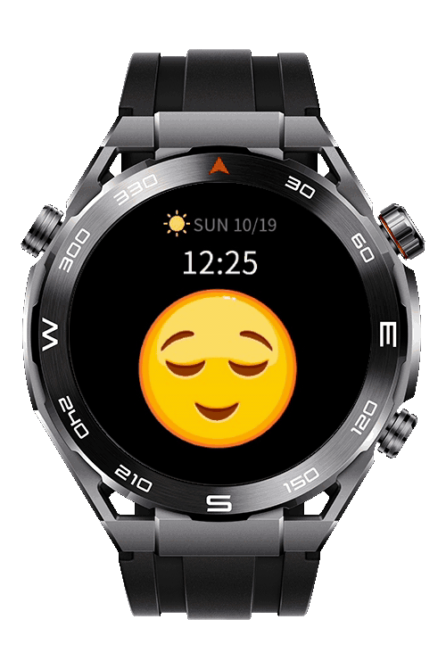

> **Note:** To access all shared projects, get information about environment setup, and view other guides, please visit [Explore-In-HMOS-Wearable Index](https://github.com/Explore-In-HMOS-Wearable/hmos-index).

# How To Implement Interactive Watch Face with Image Animator

A sample application demonstrating a touch-based interactive watch face for HarmonyOS Lite Wearables. It features a mock display for time, date, and weather, and a large, touch-responsive animated emoji using the `<image-animator>` component for dynamic interaction.

# Preview
<p align="left">
    
</p>

# Use Cases
* Displaying essential watch face elements (time, date, mock weather).
* Implementing large, dynamic UI elements (emoji) that respond to user touch interaction.
* Utilizing the **`<image-animator>`** component for smooth, frame-based animation.

# Technology Stack
**Languages**: JS  
**Frameworks**: HarmonyOS SDK 5.0.0(12)  
**Tools**: DevEco Studio 5.1.0  
**Libraries/Kits**:
- HarmonyOS JS Lite Components (specifically `<image-animator>`)

# Directory Structure
```
entry\src\main\js
└───MainAbility
    │   app.js
    ├───common
    │   └───assets
    └───pages
        └───index
                index.css
                index.hml
                index.js
```

# Constraints and Restrictions

## Supported Device
  - Huawei Sport (Lite) Watch GT 4/5/6
  - Huawei Sport (Lite) GT4/5 Pro
  - Huawei Sport (Lite) Fit 3/4
  - Huawei Sport (Lite) D2
  - Huawei Sport (Lite) Ultimate

# License

**ImageAnimator** is distributed under the terms of the **MIT License**.  
See the [LICENSE](LICENSE) file for more information.  